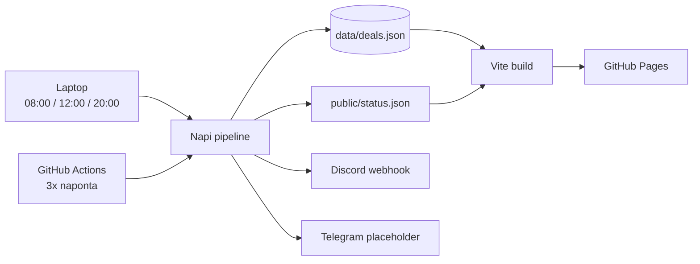
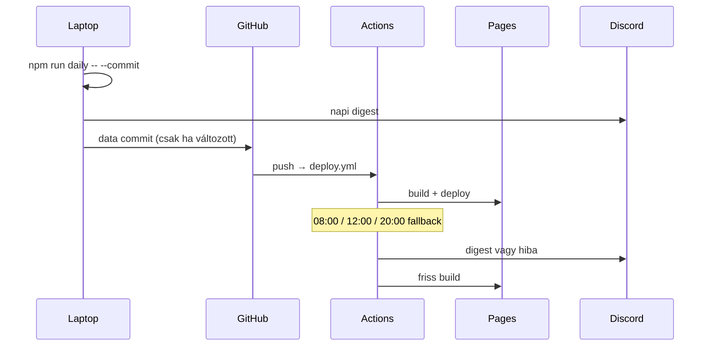

# Big-deal radar

> **Ritka, nagy dobások. Nem a napi aprókedvezmények.**
>
> Budapest és Magyarország legjobb évente visszatérő dealjei egy helyen – szűrhető weboldalon, napi Discord-digesttel, GitHub Actions fallbackkel.
>
> **Élő oldal:** [https://gyuri125.github.io/big-deal-radar/](https://gyuri125.github.io/big-deal-radar/)
>
> **Minőség:** Lighthouse 100/100/100 (Accessibility, Best Practices, SEO) · 12 automata teszt · titokszivárgás-ellenőrzés minden CI futásban.

A projekt a **„Cinema City Filmünnep”** típusú alkalmakra épül: amikor nem 10%-ot adnak, hanem 4 napig **minden mozijegy ugyanannyi**, a 4DX is. Ilyen még a Múzeumok Éjszakája, a Színházak Éjszakája, a Restaurant Week, a Corvin Mozi Éjszaka vagy a Budapest100.

---

## Tartalom

- [Mi ez?](#mi-ez)
- [A 4 deal-típus](#a-4-deal-típus)
- [Hogyan működik?](#hogyan-működik)
- [Gyors indítás](#gyors-indítás)
- [Titkok és biztonság](#titkok-és-biztonság)
- [Napi futás a laptopon](#napi-futás-a-laptopon)
- [GitHub Pages beállítás](#github-pages-beállítás)
- [GitHub Actions](#github-actions)
- [Hibrid működés](#hibrid-működés)
- [Adatmodell](#adatmodell)
- [Parancsok](#parancsok)
- [Hibakeresés](#hibakeresés)
- [Mappastruktúra](#mappastruktúra)
- [Roadmap](#roadmap)

---

## Mi ez?

Egy statikus, GitHub Pagesen futó **deal-radar**, ami:

- 100+ magyar/budapesti deal-ötletet tart nyilván,
- a következő 7 nap eseményeit és a havi radarot mutatja,
- szűrhető típus, kategória, helyszín és szabadszöveges keresés szerint,
- minden eseményhez **naptárba tehető ICS** fájlt ad, **14 nappal, 7 nappal, 1 nappal és aznap** emlékeztetővel,
- **saját lista + prioritás** a böngészőben, regisztráció nélkül,
- ahol van, **jegyvásárlási / foglalási link** és foglalási útmutató,
- **minden dealhez legalább egy forrás**, ahol releváns, több is; a részletek ablakban listázva,
- **3 másodperces hover tooltip** a linkeken: megmutatja, hová visz,
- **„Nekem” gyorsszűrők**: mozi, ételek, programok, ünnepek, ingyenes,
- **Mikor / Ár szűrők**: Ma, Hétvége, 7 nap, Ingyenes, 5 ezer alatt, 10 ezer alatt,
- **naptárnézet** havi bontásban, hónap-naptár letöltéssel,
- **egyedi deal-oldalak** SEO-val, OG képpel és Event structured data-val,
- **PWA**: telepíthető, offline is működik,
- **hibabejelentés** GitHub Issue-val, heti linkellenőrzéssel,
- naponta **Discord digestet** küld,
- Telegramhoz előkészített, de opcionális csatornával rendelkezik,
- a laptopon és GitHub Actionsben is ugyanazt a pipeline-t futtatja.

A cél nem az, hogy minden akciót összegyűjtsön. Hanem hogy **időben elkapd a nagyokat**.

---

## A 4 deal-típus

| Típus | Mit jelent | Példa |
|---|---|---|
| ★ **Prémium ugyanannyi** | Egy ár, a prémium is benne | Cinema City Filmünnep: 4DX = 2D |
| 🎟️ **Egy jegy, sok helyszín** | Egy karszalag/jegy, több intézmény | Múzeumok Éjszakája, Corvin Mozi Éjszaka |
| 🆓 **Ingyenes, de nagy értékű** | Olyan helyek nyílnak meg, ahová máskor fizetnél | Budapest100, Erőművek Éjszakája |
| 💰 **Évi nagy pénzügyi dobás** | Támogatás, adójóváírás, banki bónusz | Nyugdíjpénztári 20%, otthonfelújítási támogatás |

A weboldalon ezek a szűrők: **★ Prémium**, **Ingyenes**, **Akció**, **Pénzügy**, **Hozzáférés**.

---

## Hogyan működik?





A pipeline lépései:

1. Beolvassa a `data/deals.json`-t.
2. Zod-dal validálja a mezőket és az egyedi ID-ket.
3. Kiszámolja a következő 7 napot, a havi radarot és a pénzügyi határidőket.
4. Kiírja a `public/status.json`-t (a weboldal ezt jeleníti meg a láblécben).
5. Discordra (és opcionálisan Telegramra) küldi a digestet.
6. Buildinget készít a `dist/` mappába.
7. Csak akkor commitol, ha a `data/` alatt tényleg változás történt.

---

## Gyors indítás

### 1. Előfeltételek

- Node.js 20+ (a projekt Node 24-gyel készült)
- npm
- Git

### 2. Telepítés

```bash
npm install
```

### 3. Titkok beállítása

```bash
copy .env.example .env
```

Windows PowerShellben:

```powershell
Copy-Item .env.example .env
```

Töltsd ki a `.env`-et:

```env
DISCORD_WEBHOOK_URL=https://discord.com/api/webhooks/...
TELEGRAM_BOT_TOKEN=
TELEGRAM_CHAT_ID=
SITE_URL=https://felhasznalonev.github.io/big-deal-radar/
TZ=Europe/Budapest
```

### 4. Adatok betöltése

A 100+ lista a `budapesti-100-big-deal.md` fájlban van. A top dealek pontos dátumát, árát és forrását a `data/overrides.json` adja hozzá; a forrásokat, címkéket és ármagyarázatokat külön adatfájlok egészítik ki.

```bash
npm run import
npm run validate
```

### 5. Helyi fejlesztés

```bash
npm run dev
```

Megnyílik a `http://localhost:5173`.

### 6. Első dry-run

```bash
npm run daily -- --dry-run --verbose
```

Ez mindent kiszámol, de nem küld, nem ír és nem commitol.

### 7. Éles próba

```bash
npm run daily -- --no-build --no-notify
npm run build
```

---

## Titkok és biztonság

### Lokális fejlesztés

A titkok a `.env` fájlban vannak. Ez **soha nem kerül a repóba**.

### GitHub Actions

A titkokat a GitHubon kell beállítani:

**Settings → Secrets and variables → Actions → New repository secret**

| Secret | Kötelező? | Mire kell? |
|---|---|---|
| `DISCORD_WEBHOOK_URL` | Igen, ha Discordot akarsz | Napi digest és hibaértesítés |
| `TELEGRAM_BOT_TOKEN` | Nem | Telegram digest (placeholder) |
| `TELEGRAM_CHAT_ID` | Nem | Telegram digest (placeholder) |
| `SITE_URL` | Nem | A digestben megjelenő link; ha nincs, a workflow kiszámolja |

> **Fontos:** a Discord webhook és a Telegram token **soha nem kerülhet a frontend kódba**. Csak a pipeline használja.

### Discord webhook beállítása

1. Discordban nyisd meg a csatornát, ahová az értesítéseket akarod.
2. **Edit Channel → Integrations → Webhooks → New Webhook**.
3. Másold ki a webhook URL-t.
4. Tedd be a `.env`-be `DISCORD_WEBHOOK_URL` néven, vagy GitHubon a repository secretbe.
5. Teszteld:

```bash
npm run test-notify
```

### Telegram (opcionális)

A Telegram egyelőre **placeholder**. Ha később szeretnéd:

1. A [@BotFather](https://t.me/BotFather) segítségével készíts botot.
2. Kérd le a bot tokent.
3. Add meg a `TELEGRAM_BOT_TOKEN` és `TELEGRAM_CHAT_ID` értékeket.
4. A kód már készen áll rá: `src/notifiers/telegram.ts`.

Ha nincs beállítva, a pipeline csak egy figyelmeztetést ír a logba, és megy tovább.

### Biztonsági ellenőrzés

```bash
npm run check:secrets
```

Ez végigfut a tracked fájlokon, és megkeresi a Discord webhook / Telegram token mintákat, valamint azt, hogy a `.env` értékei nem szivárogtak-e ki.

A `.gitignore` szigorú:

- `.env`, `.env.*` (kivéve `.env.example`)
- `node_modules/`, `dist/`, `logs/`, `coverage/`
- `data/state.json`, `public/status.json` (generált)
- IDE/OS fájlok

---

## Napi futás a laptopon

### Telepítés

```powershell
powershell -NoProfile -ExecutionPolicy Bypass -File scripts/install-task.ps1
```

Ez három Windows Task Scheduler feladatot hoz létre:

- `BigDealRadar-0800`
- `BigDealRadar-1200`
- `BigDealRadar-2000`

A feladat a `scripts/daily.ps1`-t futtatja, ami:

1. a projekt gyökerébe lép,
2. logot ír a `logs/daily-YYYY-MM-DD.log` fájlba,
3. lefuttatja a `npm run daily -- --commit` parancsot,
4. hibánál nem némul el, hanem láthatóan elbukik.

### Mikor küld értesítést?

- **08:00:** teljes napi digest.
- **12:00 és 20:00:** csak akkor, ha van 3 napon belüli esemény vagy foglalásnyitás. Így nem spam.
- Kényszerített digest: `npm run daily -- --force-notify`.

### Kézi futtatás

```powershell
powershell -NoProfile -ExecutionPolicy Bypass -File scripts/daily.ps1
```

Vagy közvetlenül:

```bash
npm run daily -- --commit
```

### Törlés

```powershell
powershell -NoProfile -ExecutionPolicy Bypass -File scripts/remove-task.ps1
```

### Ha a laptop ki van kapcsolva

A Task Scheduler `StartWhenAvailable` beállítása miatt a feladat a következő bekapcsoláskor lefut. Emellett a GitHub Actions napi fallbackje is fut, tehát a Pages oldal nem marad üresen.

---

## GitHub Pages beállítás

1. Hozz létre egy **publikus** GitHub repót.
2. Pushold fel a projektet a `main` ágra.
3. Menj a **Settings → Pages** menübe.
4. A **Build and deployment → Source** legyen **GitHub Actions**.
5. Futtasd a **Actions → Napi radar → Run workflow** parancsot egyszer kézzel.
6. A deploy után az oldal itt lesz:

```text
https://<felhasznalonev>.github.io/<repo-nev>/
```

> **Miért publikus?** Ingyenes GitHub-fiók esetén a GitHub Pages csak publikus repóból működik. Ha privát kell, akkor GitHub Pro/Team vagy Cloudflare Pages/Netlify lehet a megoldás. A titkok így is biztonságban vannak: GitHub Secretsben, nem a kódban.

Ha a `SITE_URL` repository variable-t beállítod, a digestben és a weboldalon is a saját linked jelenik meg.

### Első push GitHubra

A projekt lokálisan már git repo, de a remote-ot neked kell beállítani:

```bash
git remote add origin https://github.com/<felhasznalonev>/<repo-nev>.git
git push -u origin main
```

Ha még nincs commit:

```bash
git init -b main
git add .
git commit -m "feat: Big-deal radar alapverzió"
git remote add origin https://github.com/<felhasznalonev>/<repo-nev>.git
git push -u origin main
```

> A repó neve legyen például `big-deal-radar`. Ha más nevet használsz, a `SITE_URL`-t és a Pages URL-t is annak megfelelően állítsd.

---

## GitHub Actions

Három workflow van:

| Workflow | Mikor fut? | Mit csinál? |
|---|---|---|
| `pipeline.yml` | Naponta 3x + kézzel | Validál, digestet küld, buildel, deployol, szükség esetén commitol |
| `deploy.yml` | `main` pushra, ha data/site változik | Buildel és Pagesre deployol |
| `ci.yml` | PR és `main` push (kivéve data) | Lint, teszt, titokellenőrzés, build |
| `link-check.yml` | Hetente + kézzel | Forráslinkek ellenőrzése, hiba esetén Discord-riasztás |

A napi cron **UTC-ben** van:

```yaml
- cron: '0 7 * * *'   # 08:00 Budapest (téli idő)
- cron: '0 11 * * *'  # 12:00 Budapest (téli idő)
- cron: '0 19 * * *'  # 20:00 Budapest (téli idő)
```

Nyáron ezek 09:00 / 13:00 / 21:00 helyi idő szerint futnak, mert a cron nem kezeli a nyári időszámítást. Ez tudatos kompromisszum; a laptopos futás a pontos.

---

## Hibrid működés

A laptop az elsődleges, a GitHub Actions a fallback.

- A laptop **csak akkor commitol**, ha a `data/` alatt változás van. Napi üres commit nincs.
- A laptop futása után a push triggereli a `deploy.yml`-t, tehát a Pages frissül.
- Ha a laptop nem futott, a GitHub Actions 3x naponta lefut, és frissíti az oldalt.
- A `public/status.json` és a `data/state.json` generált, ezért nincs a repóban.
- A weboldal a `status.json`-ból mutatja az utolsó futást és a következő időpontokat.
- Ha 48 óránál régebbi az adat, a weboldalon figyelmeztetés jelenik meg (a `status.json` időbélyege alapján).

---

## Adatmodell

Egy deal így néz ki a `data/deals.json`-ban:

```json
{
  "id": "cinema-city-filmunnep",
  "title": "Cinema City Filmünnep",
  "category": "kultura",
  "type": "flat",
  "timing": "Október eleje, 4 nap",
  "date_start": "2026-10-08",
  "date_end": "2026-10-11",
  "booking_opens": null,
  "month": 10,
  "months": [10],
  "recurrence": "annual",
  "deal": "Minden jegy 1690 Ft – 2D, 3D, IMAX, 4DX, ScreenX is",
  "normal_price": 3100,
  "deal_price": 1690,
  "price_note": "A normál 2D jegy árához képest; a 4DX/IMAX is ugyanannyi.",
  "currency": "HUF",
  "location": "Budapest",
  "source_url": "https://www.cinemacity.hu",
  "booking_url": "https://www.cinemacity.hu",
  "booking_note": "A jegyvásárlás online és a pénztárakban is lehetséges.",
  "sources": [
    {
      "label": "Hivatalos oldal",
      "url": "https://www.cinemacity.hu",
      "type": "official"
    },
    {
      "label": "PC Guru cikk",
      "url": "https://www.pcguru.hu/...",
      "type": "article"
    }
  ],
  "confidence": "verified",
  "last_checked": "2026-11-20",
  "tags": ["kultura", "flat", "budapest"],
  "notes": "2026-ban október 8–11. között.",
  "featured": true
}
```

### Mezők

| Mező | Jelentés |
|---|---|
| `type` | `flat`, `free`, `sale`, `money`, `access` |
| `category` | `mozi`, `kultura`, `muzeum`, `gasztro`, `utazas`, `vasarlas`, `penzugy`, `egeszseg`, `csalad`, `egyeb` |
| `recurrence` | `annual`, `monthly`, `weekly`, `daily`, `continuous`, `oneoff` |
| `date_start` / `date_end` | Referenciadátum; éves eseménynél a következő előfordulást a kód számolja |
| `month` / `months` | Havi szűréshez, akkor is, ha nincs pontos dátum |
| `confidence` | `verified`, `needs-check`, `unverified` |
| `normal_price` / `deal_price` | A megtakarítás számításához |
| `price_note` | Ha nincs pontos normál ár, itt magyarázzuk az árat |
| `last_checked` | Utolsó kézi ellenőrzés dátuma |
| `source_url` | Hivatalos forrás / cikk linkje |
| `booking_url` | Jegyvásárlás vagy foglalás linkje |
| `booking_note` | Hogyan és mikor érdemes előre venni/foglalni |
| `sources` | Több forrás: hivatalos, jegy, cikk, keresés |

### Hogyan kerül be új deal?

1. Írd be a `budapesti-100-big-deal.md` táblázatába.
2. Ha pontos dátumot, árat vagy foglalási adatot akarsz hozzáadni, tedd a `data/overrides.json`-ba.
3. A forrásokat a `data/sources.json`-ba, a program/ünnepi címkéket a `data/tags.json`-ba, az ármagyarázatot a `data/price-notes.json`-ba tedd.
4. Ha a deal neve pontosításra szorul, a `data/titles.json`-ban írd felül.
5. Az ellenőrzés dátumát a `data/meta.json`-ban frissítsd.
6. Futtasd:

```bash
npm run import
npm run validate
```

> A `data/deals.json` **generált kimenet**. Ha kézzel szerkeszted, ne futtasd utána az `npm run import`-ot, mert felülírja. A javasolt út a markdown + overrides.

---

## Hogyan ne maradj le? (előrejelzés)

A cél, hogy ne az esemény napján szembesülj vele, hogy elment a lehetőség.

1. **Napi digest** – a Discord megkapja a következő 7 nap eseményeit, a havi radarot és a jegyvásárlási/foglalási teendőket.
2. **Saját listám** – a kártyákon a **☆** ikonnal követheted, ami érdekel. A lista a böngésződben tárolódik, nem kell hozzá regisztráció.
3. **Prioritás** – a részletek ablakban 1–3 csillaggal jelölheted, mi a fontos. A saját listában prioritás szerint rendezve jelenik meg.
4. **Naptárba emlékeztetővel** – a letöltött ICS nem csak egy esemény: **14 nappal előtte, 7 nappal előtte, 1 nappal előtte és aznap** is emlékeztet. Ez a legmegbízhatóbb védelem, mert a naptárad akkor is szól, ha a weboldalt nem nyitod meg.
5. **Jegyvásárlás / foglalás** – ahol van hivatalos link, a részletek ablakban külön gomb visz a jegyvásárlásra vagy foglalásra, a `booking_note` pedig elmagyarázza, mire figyelj.
6. **Foglalásnyílás** – ha egy dealnél ismert a `booking_opens` dátum, a napi digest külön „Jegyvásárlás / foglalás” szekcióban jelzi, és a naptárba külön esemény is bekerül.

> **Mi hiányzik még?** A statikus oldal nem tud e-mailt vagy push értesítést küldeni minden egyes felhasználónak. A megbízható megoldás a naptár-emlékeztető. Ha később valódi felhasználói fiókok és e-mail/push értesítés kellenek, ahhoz backend és hitelesítés kell; ez külön projekt.

---

## Források, linkek és tooltip

A `data/sources.json` minden dealhez forrásokat rendel. A részletek ablakban ezek listázva vannak:

- **Hivatalos oldal** – a szervező oldala
- **Jegyvásárlás / foglalás** – közvetlen jegy- vagy asztalfoglalás
- **Cikk / ajánló** – háttérinformáció, összefoglaló
- **Keresés** – ha nincs egyetlen hivatalos oldal, keresőlink (ezt később finomíthatjuk)

Ha az egérrel **3 másodpercig** egy linken maradsz, lebegő tooltip mutatja a teljes URL-t, hogy lásd, hová visz. Mobilon a link koppintással nyílik.

A linkek ellenőrzése:

```bash
npm run check:links
```

Ez végigfut az összes forráson, és jelzi a 404-et, a törött linket és a botblokkokat. A botblokkolt oldalak böngészőből általában működnek.

---

## Naptár és heti terv

A főoldalon a **Lista / Naptár** kapcsolóval havi nézetre válthatsz.

- A naptárban csak a **pontos dátumú** dealek jelennek meg.
- A cellákban a dealek kattinthatók, megnyitják a részleteket.
- **Hónap naptárba** gombbal az adott hónap összes eseménye letölthető ICS-ben.
- A **Következő 7 nap naptárba** gomb a következő hét eseményeit tölti le.
- A **Ma / Hétvége / 7 nap** szűrők gyorsan leszűkítik a listát.
- Az **Ár** szűrők: Ingyenes, 5 ezer alatt, 10 ezer alatt, 10 ezer felett.

A **Heti top 5** doboz a szerkesztői válogatást mutatja a legnagyobb dobásokból.

---

## Egyedi deal-oldalak és SEO

Minden dealhez külön statikus oldal készül:

```text
https://gyuri125.github.io/big-deal-radar/deal/cinema-city-filmunnep/
```

Ezek az oldalak:

- külön címmel és leírással rendelkeznek,
- **OG / Twitter kártyát** kapnak (egyedi OG képpel),
- **schema.org Event** structured data-t tartalmaznak (dátum, helyszín, ár, jegyvásárlási link),
- a **Megosztás** gombbal másolható / megosztható a link,
- a részletek ablakból is megnyithatók.

A `sitemap.xml` automatikusan elkészül, a `robots.txt` pedig hivatkozik rá.

---

## PWA

Az oldal telepíthető telefonra:

- manifest + ikonok,
- service worker,
- offline elérés a korábban betöltött tartalomhoz.

---

## Hibabejelentés és linkellenőrzés

- Minden deal részleteinél van **„Hibát jelentek”** gomb, ami előre kitöltött GitHub Issue-t nyit.
- A **heti linkellenőrzés** GitHub Actions workflow (`link-check.yml`) végigfut a forrásokon.
- Ha broken linket talál, Discordra megy a riasztás.
- Kézzel: `npm run check:links`.

---

## Parancsok

| Parancs | Mit csinál? |
|---|---|
| `npm run dev` | Helyi Vite fejlesztői szerver |
| `npm run build` | Éles build + deal-oldalak + OG képek + sitemap |
| `npm run import` | Markdown + overrides → `data/deals.json` |
| `npm run validate` | Adatbázis validálása |
| `npm run daily` | Napi pipeline (digest + build) |
| `npm run daily -- --dry-run --verbose` | Mindent kiszámol, de nem ír/küld/commitál |
| `npm run daily -- --no-notify --no-build` | Csak státuszfrissítés |
| `npm run daily -- --commit` | Pipeline + commit/push, ha van adatváltozás |
| `npm run daily -- --force-notify` | Digest kényszerített küldése |
| `npm run doctor` | Önellenőrzés: Node, env, adat, git |
| `npm run test-notify` | Teszt Discord/Telegram üzenet |
| `npm test` | Vitest tesztek |
| `npm run lint` | TypeScript ellenőrzés |
| `npm run check:secrets` | Titokszivárgás keresése |
| `npm run check:links` | Forráslinkek ellenőrzése |

---

## Hibakeresés

| Tünet | Valószínű ok | Megoldás |
|---|---|---|
| `Nem találom a deal adatbázist` | Nincs `data/deals.json` | `npm run import` |
| `A deal adatbázis hibás` | Rossz mező / hiányzó érték | A hibaüzenet megmondja a mezőt; javítsd, majd `npm run validate` |
| Discord nem küld | Nincs `DISCORD_WEBHOOK_URL` | `.env` kitöltése, majd `npm run test-notify` |
| Discord 401/404 | Hibás vagy törölt webhook | Új webhook a Discord csatorna beállításaiban |
| Telegram nem küld | Nincs token/chat ID | Opcionális; hagyd üresen, vagy állítsd be |
| A Pages nem frissül | Nincs beállítva a GitHub Actions source | Settings → Pages → Source: GitHub Actions |
| A Pages 404 | Rossz reponév vagy privát repo | Ellenőrizd a `SITE_URL`-t és a repo láthatóságát |
| A laptop nem commitol | Nincs adatváltozás | Ez normális; csak változás esetén commitol |
| `git push` hiba | Nincs bejelentkezve / nincs jogosultság | `git remote -v`, `gh auth status`, SSH kulcs |
| Az oldal üres | JS hiba | `npm run dev`, majd böngésző konzol; vagy `?debug=1` |
| Régi dátumok | Az adat 2026-os referencia | Frissítsd a `date_start` mezőket az aktuális évre |

### Debug mód

Nyisd meg:

```text
http://localhost:5173/?debug=1
```

Ilyenkor a lábléc fölött megjelenik egy panel az adatokról, a státuszról és a számokról.

### Doctor

```bash
npm run doctor
```

Ellenőrzi:

- Node verzió,
- `.env` megléte,
- Discord webhook formátum,
- Telegram beállítás,
- adatbázis validitás,
- git repo és remote,
- státuszfájl.

---

## Mappastruktúra

```text
big-deal-radar/
├─ .github/workflows/
│  ├─ pipeline.yml        # napi adatfrissítés + digest + deploy
│  ├─ deploy.yml          # push → Pages deploy
│  ├─ link-check.yml      # heti linkellenőrzés
│  └─ ci.yml              # lint, teszt, titokellenőrzés, build
├─ data/
│  ├─ deals.json          # 100+ deal (generált a markdownból)
│  ├─ overrides.json      # top dealek pontos dátumai/árai/foglalási adatai
│  ├─ sources.json        # dealenkénti források, cikkek, jegyvásárlás
│  ├─ tags.json           # program / ünnepi / évfordulós címkék
│  ├─ titles.json         # dealnevek pontosítása (pl. Coffee Week)
│  ├─ price-notes.json    # ármagyarázatok
│  ├─ meta.json           # utolsó ellenőrzés dátuma
│  └─ state.json          # generált, gitignore-olt
├─ public/
│  └─ status.json         # generált, gitignore-olt
├─ scripts/
│  ├─ import-markdown.ts  # markdown → JSON
│  ├─ check-secrets.ts    # titokszivárgás-ellenőrzés
│  ├─ check-links.ts      # forráslinkek ellenőrzése
│  ├─ build-deal-pages.ts # egyedi deal-oldalak, OG képek, sitemap
│  ├─ daily.ps1           # Task Scheduler belépő
│  ├─ install-task.ps1    # 08:00 / 12:00 / 20:00 telepítés
│  └─ remove-task.ps1     # feladatok törlése
├─ src/
│  ├─ cli.ts              # daily / validate / doctor / test-notify
│  ├─ config.ts           # .env + Zod
│  ├─ types.ts            # Deal típusok
│  ├─ pipeline/           # load, digest
│  ├─ notifiers/          # discord, telegram
│  ├─ site/               # main.ts, style.css
│  └─ utils/              # dates, logger
├─ tests/                 # Vitest tesztek
├─ budapesti-100-big-deal.md
├─ big-deal-otletek.md
├─ index.html
├─ package.json
├─ tsconfig.json
└─ vite.config.ts
```

---

## Roadmap

- [x] Saját lista, prioritás, naptár-emlékeztető.
- [x] Minden dealhez forrás, több forrás, hover tooltip.
- [x] Naptárnézet, Ma / Hétvége / 7 nap és ár szerinti szűrők.
- [x] Heti top 5, egyedi deal-oldalak, OG képek, Event structured data.
- [x] PWA, offline mód, megosztható linkek.
- [x] Heti linkellenőrzés és hibabejelentés.
- [ ] A maradék 63 dealhez pontos dátum, ahol lehet.
- [ ] A 18 keresőlinkes dealhez konkrét hivatalos forrás.
- [ ] Normál árak feltöltése a top 30-hoz.
- [ ] Foglalásnyílási dátumok (booking_opens) a top 10-hez.
- [ ] Automatikus forrásfigyelés (Cinema City, Múzeumok Éjszakája, Restaurant Week).
- [ ] Közösségi szavazás: „megérte?” / „nem érte meg” (backend kell hozzá).
- [ ] Telegram bot élesítése, ha lesz token.
- [ ] Angol nyelvű verzió (opcionális).

---

## Források

A dátumok és árak 2026-os példák, és évente változnak. A részleteket mindig a hivatalos oldalon ellenőrizd:

- Cinema City – [cinemacity.hu](https://www.cinemacity.hu)
- Múzeumok Éjszakája – [muzej.hu](https://muzej.hu)
- Budapesti Színházak Éjszakája – [bpsze.hu](https://bpsze.hu)
- Restaurant Week – [etteremhet.hu](https://etteremhet.hu)
- Budapest100 – [budapest100.hu](https://budapest100.hu)
- Erőművek Éjszakája – [eromuvekejszakaja.hu](https://eromuvekejszakaja.hu)
- Fővárosi Nagycirkusz – [fovarosinagycirkusz.hu](https://fovarosinagycirkusz.hu)

---

**Készült magyarul, magyar dealekhez.** 🇭🇺
